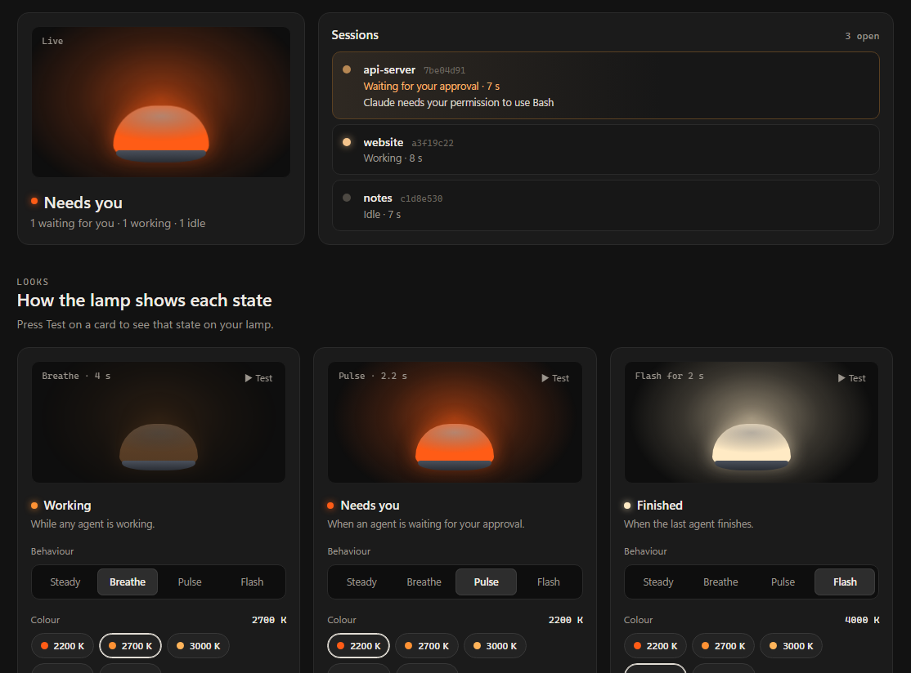

# Tally

Tally turns a Philips Hue Bluetooth lamp into a status light for [Claude Code](https://claude.com/claude-code),
like the on-air tally light on a studio camera. You can see from across the room whether Claude is working,
waiting for your approval, or done.

| Claude Code is… | The lamp… (you choose the looks) |
|---|---|
| working | glows a steady warm white |
| waiting for your approval | pulses |
| finished | flashes, then goes back to how you left it |

It follows every Claude Code session at once, on Windows and in WSL, and talks to the lamp over Bluetooth.
No Hue Bridge is needed.



## Install

You need Windows 10 or 11 with Bluetooth, a Philips Hue lamp with Bluetooth, and Claude Code.

1. Download **TallySetup** from the [latest release](https://github.com/n-k-12/tally/releases/latest) and run it.
   Windows may say *"Windows protected your PC"* because the installer isn't code-signed yet:
   choose **More info → Run anyway**.
2. Tally opens a short setup in your browser:
   1. **Find your lamp**: scan, then pick it.
   2. **Connect Claude Code**: one click each for Windows and any WSL distros where Claude Code is installed.
   3. **Choose the looks**: colour, brightness and behaviour for each state, with a Test button.

After that Tally lives in the system tray. Click its lamp icon to open the dashboard: live sessions,
the looks, an idle light, quiet hours, pausing, and your lamp's colour range.

### Lamp not found?

- Make sure Bluetooth is on.
- Make the lamp visible: in the Hue app, look for the option to make it visible to other devices
  (often under *Settings → Voice assistants*), or switch the lamp off and on at the wall.
- Pair it with Windows: *Settings → Bluetooth & devices → Add device → Bluetooth*, then pick the lamp.
- Scan again in Tally.

## How it works

Tally runs a small web server on your own PC at `http://127.0.0.1:4567`. Claude Code
[hooks](https://docs.claude.com/en/docs/claude-code/hooks) tell it when each session starts working,
needs permission, finishes or closes. In WSL the hooks use Windows' `curl.exe`, so they reach Tally
whatever your WSL networking mode.

Connecting Claude Code adds five hooks to its `settings.json` and keeps everything else in that file.
The first time, the original is saved next to it as `settings.json.before-tally`.

**Privacy:** nothing leaves your PC except a once-a-day check of this repository's releases for a newer
version. You can turn that off from the tray menu.

## Uninstall

Use *Settings → Apps → Tally → Uninstall*. This also takes Tally's hooks out of Claude Code.
Your settings stay in `%APPDATA%\Tally` in case you reinstall; delete that folder to remove them too.

## Development

```sh
python -m tally --fake --no-tray --port 4999   # a pretend lamp that prints to the terminal
```

Then open http://127.0.0.1:4999/. `TALLY_DATA=some/folder` keeps test settings apart from your real ones.

To build `TallySetup.exe` on Windows with Python 3.11+ and [Inno Setup 6](https://jrsoftware.org/isinfo.php):

```sh
python build\build.py
```

The installer lands in `dist\`.

To release, bump `__version__` in `tally/__init__.py`, commit, and push a matching tag such as `v0.1.1`.
GitHub Actions builds the installer and attaches it to a draft release; publish the draft when it looks right.

## Licence

[MIT](LICENSE). Tally is an independent project, not affiliated with or endorsed by Anthropic or Signify (Philips Hue).
